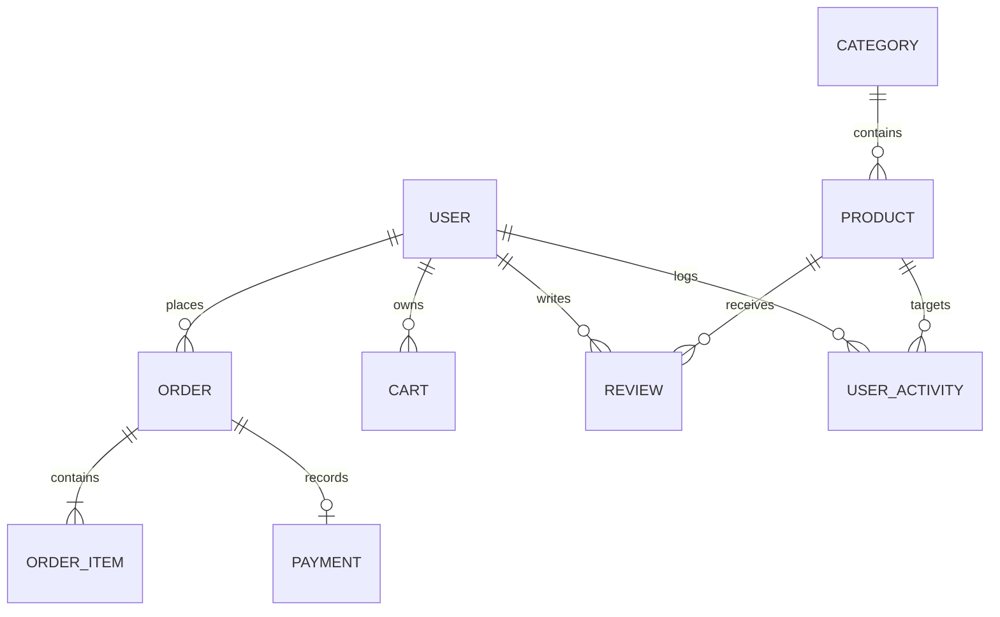

# IntelliCart AI — Database Schema Specification

This document details the MongoDB collections, schema models, indexes, relationships, and validation rules in IntelliCart AI.

---

## 1. Entity Relationship Diagram

---

## 2. Collection Schemas

### 2.1 Users (`users`)
Stores customer and administrator profiles, credentials, addresses, and wishlists.
| Field | Type | Index | Description |
| :--- | :--- | :--- | :--- |
| `_id` | ObjectId | Primary Key | Unique user identifier |
| `name` | String | No | User's full name (max 100 chars) |
| `email` | String | Unique | Lowercase normalized email address |
| `password` | String | No | bcrypt hashed password (hidden by default) |
| `role` | String | Yes | Enum: `'CUSTOMER'`, `'ADMIN'` (Default: `'CUSTOMER'`) |
| `isActive` | Boolean | Yes | Account activation status (Default: `true`) |
| `phone` | String | No | Contact telephone |
| `avatar` | String | No | Profile photo URL |
| `addresses` | Array[Address] | No | Embedded array of saved shipping addresses |
| `wishlist` | Array[ObjectId] | No | References to `Product` documents |
| `createdAt` | Date | Yes | Auto-managed timestamp |
| `updatedAt` | Date | No | Auto-managed timestamp |

### 2.2 Products (`products`)
Stores SKU catalog details, pricing, discount aliases, inventory stock, and AI metadata.
| Field | Type | Index | Description |
| :--- | :--- | :--- | :--- |
| `_id` | ObjectId | Primary Key | Unique product identifier |
| `name` | String | Text | Product title (max 200 chars) |
| `slug` | String | Yes | URL-safe slug auto-generated from name |
| `description` | String | Text | Detailed product specifications |
| `brand` | String | Text | Brand/Manufacturer name |
| `category` | ObjectId | Yes | Foreign Key referencing `Category` |
| `categoryName`| String | No | Denormalized category name for rapid indexing |
| `price` | Number | Yes | Base selling price in INR (min: 0) |
| `originalPrice`| Number | No | Pre-discount baseline price |
| `discountPercentage`| Number | No | Discount percentage (0-100) |
| `stock` | Number | Yes | Current available warehouse inventory units |
| `minSafetyStock`| Number | No | Minimum buffer threshold (Default: 10) |
| `reorderPoint`| Number | No | Inventory replenishment trigger (Default: 15) |
| `averageRating`| Number | Yes | Recalculated average customer rating (0-5) |
| `reviewCount` | Number | No | Total count of approved verified reviews |
| `salesCount` | Number | Yes | Total units sold across confirmed orders |
| `featured` | Boolean | Yes | Flag for promotional homepage placement |
| `tags` | Array[String] | Text | Array of keywords for search and ML matching |
| `thumbnail` | String | No | Primary showcase image URL |
| `images` | Array[String] | No | Full gallery image URLs |

*Virtuals*: `finalPrice` computes effective price after discount.

### 2.3 Orders (`orders`)
Records verified customer checkouts, items snapshot, payment info, and status lifecycle.
| Field | Type | Index | Description |
| :--- | :--- | :--- | :--- |
| `_id` | ObjectId | Primary Key | Unique order identifier |
| `user` | ObjectId | Yes | Foreign Key referencing `User` |
| `items` | Array[Item] | No | Embedded items snapshot (product, name, price, qty) |
| `shippingAddress`| Object | No | Complete shipping destination address |
| `subtotal` | Number | No | Gross items cost |
| `shippingFee` | Number | No | Flat delivery charge (free over ₹5,000) |
| `discount` | Number | No | Promotional discount deduction |
| `totalAmount` | Number | Yes | Net final payable amount in INR |
| `paymentMethod`| String | Yes | Enum: `'RAZORPAY'`, `'COD'`, `'CARD'`, `'UPI'` |
| `paymentStatus`| String | Yes | Enum: `'PENDING'`, `'PAID'`, `'FAILED'`, `'REFUNDED'` |
| `orderStatus` | String | Yes | Enum: `'PENDING'`, `'CONFIRMED'`, `'PROCESSING'`, `'SHIPPED'`, `'DELIVERED'`, `'CANCELLED'` |
| `idempotencyKey`| String | Sparse Unique | Prevents duplicate order creation during retries |
| `razorpayOrderId`| String | Yes | Gateway order reference |
| `paidAt` | Date | No | Timestamp of confirmed gateway payment |
| `deliveredAt` | Date | No | Timestamp of fulfilled customer delivery |

### 2.4 Carts (`carts`)
Transient user shopping carts with automatic stock synchronization.
| Field | Type | Index | Description |
| :--- | :--- | :--- | :--- |
| `_id` | ObjectId | Primary Key | Unique cart identifier |
| `user` | ObjectId | Yes | Foreign Key referencing `User` (1-to-1) |
| `items` | Array[Item] | No | Array of `{ product, quantity, price }` |
| `subtotal` | Number | No | Recalculated total value of items in cart |
| `shipping` | Number | No | Shipping charge calculated on save |
| `total` | Number | No | Total including delivery fees |

### 2.5 Payments (`payments`)
Audit ledger of all Razorpay payment attempts and webhook receipts.
| Field | Type | Index | Description |
| :--- | :--- | :--- | :--- |
| `_id` | ObjectId | Primary Key | Unique payment audit record |
| `user` | ObjectId | Yes | Foreign Key referencing `User` |
| `order` | ObjectId | Yes | Foreign Key referencing `Order` |
| `razorpayOrderId`| String | Yes | Razorpay order ID |
| `razorpayPaymentId`| String | Sparse | Razorpay verified transaction ID |
| `razorpaySignature`| String | No | Cryptographic signature string |
| `amount` | Number | No | Transaction value in INR |
| `status` | String | Yes | Enum: `'PENDING'`, `'PAID'`, `'FAILED'`, `'REFUNDED'` |

### 2.6 User Activities (`useractivities`)
Implicit feedback interaction events consumed by the Machine Learning recommendation engine.
| Field | Type | Index | Description |
| :--- | :--- | :--- | :--- |
| `_id` | ObjectId | Primary Key | Unique event log identifier |
| `user` | ObjectId | Compound | Foreign Key referencing `User` (nullable for guests) |
| `sessionId` | String | Yes | Anonymous persistent browser session ID |
| `product` | ObjectId | Compound | Foreign Key referencing `Product` |
| `action` | String | Compound | Enum: `'VIEW_PRODUCT'`, `'SEARCH'`, `'ADD_TO_CART'`, `'REMOVE_FROM_CART'`, `'WISHLIST'`, `'PURCHASE'` |
| `metadata` | Mixed | No | Additional context (quantity, search query, etc.) |
| `timestamp` | Date | Compound | Event timestamp |

*Compound Indexes*:
- `{ user: 1, action: 1, timestamp: -1 }`
- `{ product: 1, action: 1 }`

### 2.7 Reviews (`reviews`)
Customer ratings and reviews with ML-derived sentiment polarity scores.
| Field | Type | Index | Description |
| :--- | :--- | :--- | :--- |
| `_id` | ObjectId | Primary Key | Unique review identifier |
| `user` | ObjectId | Compound Unique | Foreign Key referencing `User` |
| `product` | ObjectId | Compound Unique | Foreign Key referencing `Product` |
| `rating` | Number | No | Integer rating (1-5) |
| `title` | String | No | Review headline |
| `comment` | String | No | Review text feedback |
| `sentiment` | String | No | ML Polarity: `'Positive'`, `'Neutral'`, `'Negative'` |
| `sentimentScore`| Number | No | Numerical polarity score (-1.0 to 1.0) |
| `sentimentConfidence`| Number | No | Model classification confidence (0.0 to 1.0) |
| `verifiedPurchase`| Boolean | No | Indicates verified order purchase |

*Compound Unique Index*: `{ product: 1, user: 1 }` (prevents multiple reviews by the same user for a single product).
