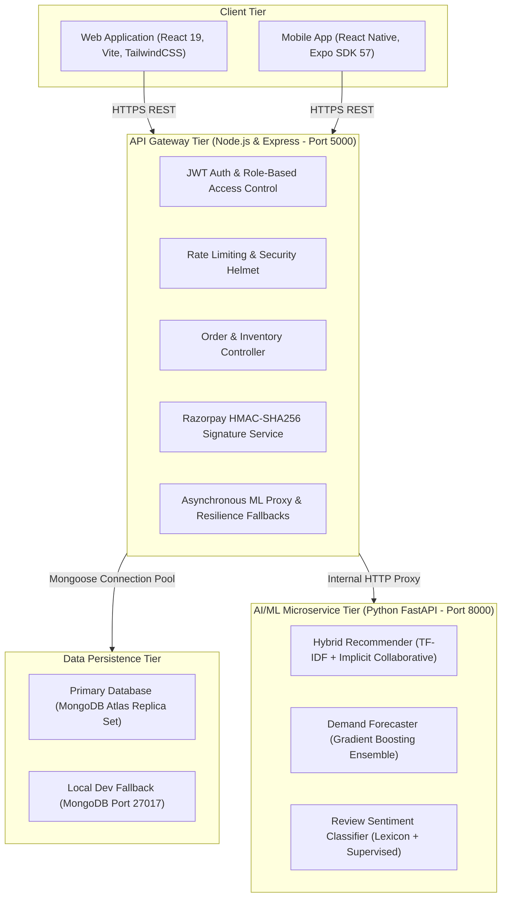

# IntelliCart AI — System Architecture Specification

## 1. Executive Architectural Overview

IntelliCart AI is an enterprise-grade, distributed e-commerce platform incorporating real-time Machine Learning and Deep Learning microservices, web and mobile client applications, cryptographic payment processing, and resilient multi-database data pipelines.

---

## 2. Component Architecture

### 2.1 Frontend Client (`frontend/`)
- **Technology**: React 19, Vite 6, Tailwind CSS 3, Recharts 2.
- **Key Features**:
  - Customer Storefront: Catalog with full-text search, multi-faceted filtering (brand, price, category, rating, in-stock), dynamic pagination, product reviews with sentiment tags.
  - Cart & Checkout: Drawer cart, server-side price validation, Razorpay checkout modal with cryptographic signature callback, and Cash on Delivery.
  - Admin Operations Center: 6 integrated modules covering Overview/Sales analytics with 14-day daily revenue charts, Product CRUD, Order status transitions, Category management, User permissions, and AI inventory intelligence.

### 2.2 Mobile Client (`mobile-app/`)
- **Technology**: React Native, Expo SDK 57, React Navigation v7, Hermes JS Engine.
- **Key Features**:
  - Native shopping experience consuming identical REST endpoints as web client.
  - Native runtime diagnostics screen allowing live switching between Android emulator (`10.0.2.2`), local Wi-Fi LAN (`192.168.X.X`), and production cloud URLs.
  - Razorpay Test Simulator with signature generation matching server HMAC rules.
  - Offline-resilient AsyncStorage token persistence.

### 2.3 Backend API Service (`backend/`)
- **Technology**: Node.js 24, Express.js 4, Mongoose 8.
- **Key Modules**:
  - `config/db.js`: Resilient database connection manager with automated WinDNS SRV resolution fallback, explicit classification for DNS, TLS, Auth, and IP allowlist errors, and clean failure in production.
  - `middleware/authMiddleware.js`: Dual-bearer token and HTTP-only cookie extraction, expiration checks, and role authorization (`CUSTOMER`, `ADMIN`).
  - `services/paymentService.js`: Server-side Razorpay order creation and HMAC-SHA256 signature verification preventing client-side price tampering.
  - `controllers/orderController.js`: Atomic inventory decrements with automated rollback on failure, idempotency key tracking, and inventory restoration on order cancellation.

### 2.4 AI/ML Microservice (`ml-service/`)
- **Technology**: Python 3.14, FastAPI, Scikit-learn, NumPy, Pandas.
- **Models**:
  - **Hybrid Recommender**: TF-IDF cosine vector matching over catalog text corpus combined with weighted implicit feedback ($W_{purchase}=5, W_{cart}=3, W_{wishlist}=2, W_{view}=1$).
  - **Demand Forecaster**: Gradient Boosting regression predicting monthly SKU unit sales ($R^2 = 0.991$) with dynamic Safety Stock ($SS = Z \times \sigma_L \times \sqrt{L}$) and Reorder Points ($ROP$).
  - **Customer Review Sentiment**: Supervised NLP pipeline classifying reviews into Positive, Neutral, and Negative polarities with discrepancy detection.

---

## 3. Communication Protocols & Security Boundaries

1. **Authentication**: Stateless JSON Web Tokens signed with HMAC-SHA256, carrying user ID, role, and email, with 7-day expiration.
2. **Payment Security**: Strict server-side verification using Razorpay shared secret. Client payments are never marked PAID without cryptographic signature validation.
3. **Data Integrity**: Idempotency keys (`idempotency-key` header) prevent duplicate orders and charge submissions during network retries.
4. **CORS & Rate Limiting**: General API limiter set to 1000 req/15min; strict auth rate limiter set to 60 req/15min to mitigate brute-force attempts.
