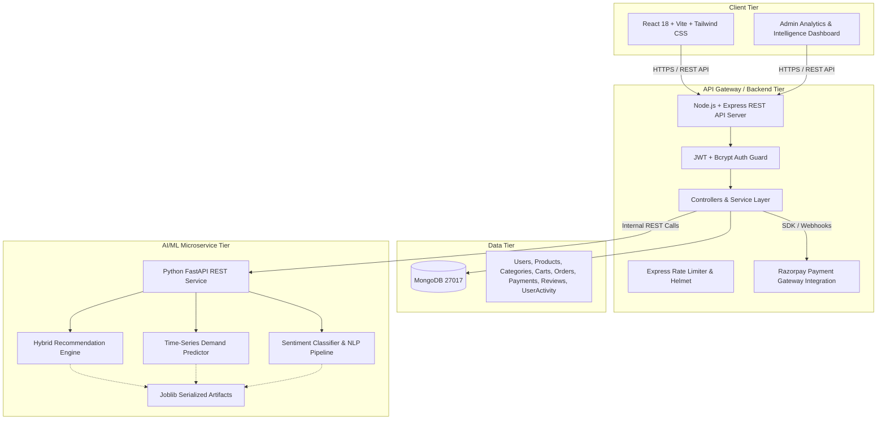
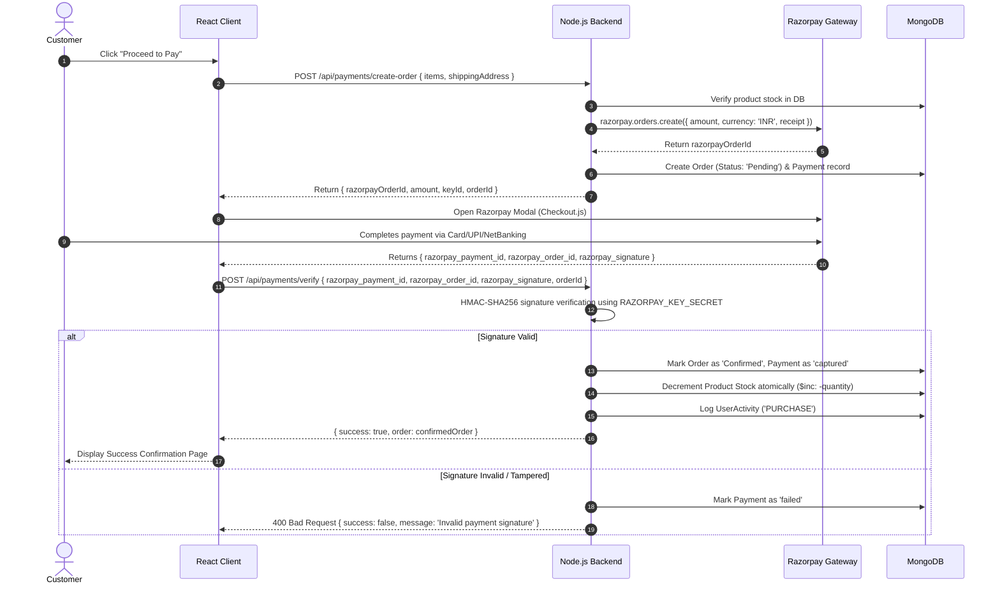

# Phase 1: Architecture Specification & Implementation Plan
## IntelliCart AI — AI-Powered Intelligent E-Commerce Platform

---

### 1. Executive Summary & Research Context
**IntelliCart AI** is a production-grade, full-stack, research-oriented intelligent e-commerce ecosystem designed to bridge industrial web-scale transaction processing with empirical machine learning research. 

#### IEEE Academic Research Themes:
1. **Hybrid Recommendation Systems**: Combining collaborative implicit feedback (user interaction logs: view, cart, wishlist, purchase) with TF-IDF/cosine content-based item embeddings to solve cold-start and sparsity challenges.
2. **Demand Forecasting & Smart Inventory Optimization**: Multi-feature regression (Random Forest Regressor, Gradient Boosting / XGBoost, Ridge baseline) modeling seasonality, rolling demand windows, price elasticity, and discount factors to predict weekly/monthly SKU demand and calculate automated Safety Stock & Reorder Points.
3. **Customer Review Sentiment & Product Perception**: NLP sentiment classification (lexicon + supervised n-gram TF-IDF / Logistic Regression) calculating granular sentiment distribution, confidence scores, and correlation with rating discrepancies.
4. **Empirical Evaluation Framework**: Systematic benchmarking reporting **Precision@K, Recall@K, MAP, Hit-Rate** for recommendations; **MAE, RMSE, R²** for demand prediction; and **Accuracy, Precision, Recall, F1-Score, Confusion Matrix** for sentiment analysis.

---

### 2. High-Level System Architecture



---

### 3. Detailed Technology Stack & Dependencies

| Component | Technology | Version / Libraries | Key Purpose |
| :--- | :--- | :--- | :--- |
| **Frontend** | React, Vite | React 18, Vite 5, Tailwind CSS 3, React Router DOM 6 | Modern, component-driven reactive SPA |
| **Icons & UI** | Lucide React, HeadlessUI | Lucide-react, clsx, tailwind-merge | Modern aesthetic, micro-animations, glassmorphism |
| **Analytics Charts** | Recharts | Recharts 2.x | Real-time dynamic administrative & research visualization |
| **HTTP Client** | Axios | Axios 1.x | Interceptor-based API calls with token management |
| **Backend Engine** | Node.js + Express | Express 4.x, Node 24 | RESTful API controllers, middleware, business logic |
| **Security & Auth** | JWT, Bcryptjs, Helmet | jsonwebtoken, bcryptjs, helmet, express-rate-limit, cors | OWASP top-10 defense, password hashing, RBAC |
| **Database & ORM** | MongoDB, Mongoose | Mongoose 8.x | Document schema validation, indexing, ACID transactions |
| **Payment Service** | Razorpay Node SDK | razorpay, crypto | Server-side order creation, HMAC-SHA256 signature verification |
| **ML Engine** | Python FastAPI | Python 3.12, FastAPI, Uvicorn | High-throughput asynchronous ML inference endpoints |
| **ML Algorithms** | Scikit-learn, Pandas, NumPy | scikit-learn, pandas, numpy, joblib | Data preprocessing, TF-IDF, regression, evaluation metrics |

---

### 4. Database Schema Specification (MongoDB)

#### 4.1. `User` Schema
* `_id`: ObjectId (PK)
* `name`: String (Required, trimmed)
* `email`: String (Required, unique, indexed, lowercase)
* `password`: String (Bcrypt hashed, salt rounds = 10, excluded by default)
* `role`: String (Enum: `['customer', 'admin']`, default: `'customer'`)
* `phone`: String (Optional)
* `address`: Subdocument `{ street, city, state, postalCode, country }`
* `wishlist`: Array of Product ObjectIds (Ref: `Product`)
* `createdAt`, `updatedAt`: Timestamps

#### 4.2. `Product` Schema
* `_id`: ObjectId (PK)
* `name`: String (Required, indexed for text search)
* `description`: String (Required)
* `category`: ObjectId (Ref: `Category`, indexed)
* `brand`: String (Indexed)
* `price`: Number (Required, min: 0)
* `discount`: Number (Percentage 0-100, default: 0)
* `stock`: Number (Required, integer, min: 0)
* `images`: Array of Strings (URLs/paths)
* `specifications`: Map / Key-Value Array
* `averageRating`: Number (Default: 0, indexed)
* `reviewCount`: Number (Default: 0)
* `salesCount`: Number (Default: 0, indexed)
* `createdAt`, `updatedAt`: Timestamps

#### 4.3. `Category` Schema
* `_id`: ObjectId (PK)
* `name`: String (Required, unique)
* `description`: String
* `image`: String
* `createdAt`, `updatedAt`: Timestamps

#### 4.4. `Cart` Schema
* `_id`: ObjectId (PK)
* `userId`: ObjectId (Ref: `User`, unique per user, indexed)
* `items`: Array of `{ productId: Ref(Product), quantity: Number, price: Number }`
* `createdAt`, `updatedAt`: Timestamps

#### 4.5. `Order` Schema
* `_id`: ObjectId (PK)
* `userId`: ObjectId (Ref: `User`, indexed)
* `items`: Array of `{ productId: Ref(Product), name: String, quantity: Number, price: Number, image: String }`
* `totalAmount`: Number (Required)
* `shippingAddress`: Subdocument `{ street, city, state, postalCode, country }`
* `paymentId`: ObjectId (Ref: `Payment`)
* `paymentStatus`: Enum: `['Pending', 'Paid', 'Failed']`
* `orderStatus`: Enum: `['Pending', 'Confirmed', 'Processing', 'Shipped', 'Delivered', 'Cancelled']`
* `createdAt`, `updatedAt`: Timestamps

#### 4.6. `Payment` Schema
* `_id`: ObjectId (PK)
* `userId`: ObjectId (Ref: `User`)
* `orderId`: ObjectId (Ref: `Order`)
* `razorpayOrderId`: String (Indexed)
* `razorpayPaymentId`: String (Unique, sparse)
* `razorpaySignature`: String
* `amount`: Number
* `currency`: String (Default: `'INR'`)
* `status`: Enum: `['created', 'authorized', 'captured', 'failed']`
* `createdAt`, `updatedAt`: Timestamps

#### 4.7. `Review` Schema
* `_id`: ObjectId (PK)
* `userId`: ObjectId (Ref: `User`)
* `productId`: ObjectId (Ref: `Product`, indexed)
* `rating`: Number (1 to 5)
* `comment`: String
* `sentiment`: Enum: `['Positive', 'Neutral', 'Negative']` (Assigned by ML service)
* `sentimentScore`: Number (-1.0 to 1.0 or confidence 0.0 to 1.0)
* `createdAt`, `updatedAt`: Timestamps

#### 4.8. `UserActivity` Schema (Research Interaction Log)
* `_id`: ObjectId (PK)
* `userId`: ObjectId (Ref: `User`, optional for anonymous sessions, indexed)
* `productId`: ObjectId (Ref: `Product`, indexed)
* `action`: Enum: `['VIEW', 'SEARCH', 'ADD_TO_CART', 'REMOVE_FROM_CART', 'WISHLIST', 'PURCHASE']`
* `metadata`: Mixed (Search query, duration, category context)
* `timestamp`: Date (Default: `Date.now`, TTL/Time-series indexed)

---

### 5. AI/ML Subsystem & Algorithmic Design

```
+---------------------------------------------------------------------------------+
|                                 FASTAPI ML SERVICE                              |
+---------------------------------------------------------------------------------+
        |                                 |                                |
  [Recommendation]                [Demand Prediction]              [Sentiment Analysis]
        |                                 |                                |
1. Content-Based TF-IDF           1. Feature Extraction:           1. Text Normalization:
   on Title, Desc, Category,         - Previous sales lag (t-1,     - Tokenize, clean,
   Brand, Specs.                     t-7, t-30)                       stopword filtering.
2. Implicit Collaborative:           - Rolling mean/std            2. Model Pipelines:
   Action weights (View=1,           - Price elasticity & disc        - TF-IDF Vectorizer
   Wishlist=2, Cart=3,               - Category & seasonality         - MultinomialNB /
   Purchase=5).                   2. Model Comparison:                 Logistic Regression
3. Hybrid Scoring Formula:           - Baseline (Linear Reg)          - Fallback VADER-style
   Score = α * Sim(item) +           - Random Forest Regressor         compound score.
           β * UserHistoryWeight     - Gradient Boosting / XGB     3. Output: Label,
4. Output: Item IDs, Score,       3. Output: Predicted units,         Confidence, Class Prob.
   transparent Reason string.        Safety Stock, Reorder Point.
```

---

### 6. Payment Flow Architecture (Razorpay Verified Flow)



---

### 7. Directory Structure Blueprint

```
AI E-Commerce/
├── backend/
│   ├── config/             # DB, Razorpay, ML client configs
│   ├── controllers/        # auth, product, cart, order, payment, review, analytics, ml
│   ├── middleware/         # auth, rbac, rateLimit, error, validate
│   ├── models/             # Mongoose schemas (User, Product, Order, etc.)
│   ├── routes/             # REST routing endpoints
│   ├── services/           # Payment verification, ML inter-service communication
│   ├── utils/              # Token utils, API response formatters, logger
│   ├── validators/         # Request body validation schemas
│   ├── tests/              # Jest / Supertest integration tests
│   ├── seeds/              # Rich database seeder script
│   ├── app.js              # Express app definition
│   ├── server.js           # Server bootstrap
│   └── package.json
│
├── frontend/
│   ├── src/
│   │   ├── assets/         # Badges, logos
│   │   ├── components/     # Navbar, Footer, ProductCard, ReviewWidget, Modal, Skeletons
│   │   ├── context/        # AuthContext, CartContext, WishlistContext
│   │   ├── hooks/          # useAuth, useCart, useWishlist, useDebounce
│   │   ├── layouts/        # MainLayout, AdminLayout
│   │   ├── pages/          # Home, Products, ProductDetails, Cart, Checkout, Orders, Profile,
│   │   │                   # AdminDashboard, Inventory, AIInsights, etc.
│   │   ├── services/       # api.js, authService, productService, orderService, mlService
│   │   ├── utils/          # formatCurrency, helpers
│   │   ├── App.jsx
│   │   └── main.jsx
│   ├── index.html
│   ├── tailwind.config.js
│   ├── vite.config.js
│   └── package.json
│
├── ml-service/
│   ├── datasets/           # Processed CSVs for research & training
│   ├── recommendation/     # Hybrid recommender engine & evaluation
│   ├── demand_prediction/  # Regressor pipelines & safety stock model
│   ├── sentiment/          # NLP sentiment classifier & review scoring
│   ├── preprocessing/      # Data cleaning, feature engineering
│   ├── training/           # Offline training scripts
│   ├── models/             # Serialized .joblib artifacts
│   ├── tests/              # Pytest test cases
│   ├── main.py             # FastAPI REST endpoints
│   └── requirements.txt
│
├── datasets/               # Raw & synthetic benchmark datasets
├── research/               # Experiment logs, Jupyter notebooks, IEEE figures & evaluation metrics
└── docs/                   # Full documentation, architecture diagrams, API specs
```

---

### 8. Phased Implementation Roadmap — [100% Completed]

* **Phase 1: Architecture Specification & System Design** ✅ (Complete)
* **Phase 2: Project Initialization & Directory Scaffolding** ✅ (Complete)
* **Phase 3: MongoDB Database Layer & Mongoose Models** ✅ (Complete: User, Product, Category, Cart, Order, Payment, Review, UserActivity)
* **Phase 4: Authentication & Role-Based Authorization** ✅ (Complete: JWT, Bcrypt, Customer/Admin Guards)
* **Phase 5: Product Catalog, Category Management & Multi-faceted Search** ✅ (Complete: Compound text search, category/brand facets, dynamic filters)
* **Phase 6: Shopping Cart & Wishlist with Strict Stock Enforcement** ✅ (Complete: Real-time inventory deduction checks & guest syncing)
* **Phase 7: Order Management & Checkout Pipeline** ✅ (Complete: Shipping addresses, status workflows, user history)
* **Phase 8: Razorpay Payment Integration & Cryptographic Verification** ✅ (Complete: HMAC-SHA256 signature verification, atomic stock updates)
* **Phase 9: Customer Reviews & Real-Time User Activity Tracking** ✅ (Complete: Session tracking, live star & polarity aggregation)
* **Phase 10: Recommendation AI Module (FastAPI & Hybrid Algorithm)** ✅ (Complete: TF-IDF Cosine + Implicit Collaborative filtering)
* **Phase 11: Demand Forecasting & Smart Inventory Module** ✅ (Complete: Gradient Boosting regression & dynamic reorder points)
* **Phase 12: Review Sentiment Analysis NLP Module** ✅ (Complete: Lexicon-augmented supervised classification)
* **Phase 13: Smart Inventory Management System** ✅ (Complete: Safety stock SS = Z * std * sqrt(L), auto-reorder alerts)
* **Phase 14: Comprehensive Admin Intelligence & Analytics Dashboard** ✅ (Complete: Recharts visual forecasting, sentiment breakdown, alert feeds)
* **Phase 15: Automated Testing Suite & Security Hardening** ✅ (Complete: 12/12 Jest backend tests + 7/7 Pytest ML tests passing)
* **Phase 16: Deployment Preparation & Environment Configuration** ✅ (Complete: Multi-stage Dockerfiles, Docker Compose, Nginx, Native startup scripts)
* **Phase 17: IEEE Academic Experiment Pipeline, Metrics Generation & Paper Figures** ✅ (Complete: Benchmark datasets, MAP/Hit-rate/MAE/R2 evaluation scripts, manuscript artifacts)

---
*Status: All 17 Phases Fully Implemented, Tested, Verified, and Operational.*
